  

  
  
  
  

 

### Currently

- 🤖 Building the dataset and oracle pod for AI@UNC's **Infinite Policy-Based RL** project (Hugging Face datasets)
- 📈 Investment researcher on UNC's **College Fed Challenge** team (macroeconomic and monetary-policy research)
- 📍 Building **MapChat**, a consent-based roommate map with an iMessage agent
- 🌱 Running **OSDA**, a bilingual sustainability questionnaire + AI chatbot
- 📱 iOS developer at **Carolina App Team** (Swift)
- 🏆 1st place, Product Build Challenge x Creset (2026) · 1st place, International Consultancy Club Case Competition

 

### Projects

| Project | What it is | Stack | Links |
|---|---|---|---|
| 🌱 **OSDA** | Sustainability questionnaire + AI chatbot in EN/PT. GYC 2026 Top 16 · Bronze | React · NestJS · PostgreSQL · Vercel AI SDK | [Live](https://osda-ai.vercel.app) · [Code](https://github.com/momacaes9/osda) |
| 🪰 **ParkFly** | NC State Hack Day 2026: sense 25% of parking spots, infer the rest, and let a 139k-neuron FlyWire fruit-fly connectome pick where to park | Python · Leaflet · JS | [Live](https://parkfly-one.vercel.app/) · [Code](https://github.com/momacaes9/parkfly) |
| 🦈 **ParkShark Duke** | Triangle AI Hackathon 2026: honest parking map for Duke with free-space forecasts and a Gemini concierge | JS · Vercel · Supabase | [Live](https://parkshark-blond.vercel.app) · [Code](https://github.com/momacaes9/parkshark) |
| 📍 **MapChat** | Consent-based roommate map with stair-aware indoor routing and an iMessage agent that texts only you | TypeScript · Swift · Supabase | [Code](https://github.com/momacaes9/mapchat) |
| 🌍 **Abroady** | Trilingual (EN/PT/ES) web app for first-year and international students to settle in and plan study abroad | HTML · JS | [Live](https://abroady.netlify.app) · [Code](https://github.com/momacaes9/abroady) |
| 🤖 **Infinite Policy-Based RL** | AI@UNC research: ExeBench → gcc → QEMU oracle → labeled Hugging Face dataset (Pod A) | Python · Docker · Hugging Face | *private* |
| 📱 **iOS Bootcamp** | App Team Carolina projects: Spotify UI, Weather, Reminders, Trivvey, Abroady Explorer | Swift · SwiftUI | [Code](https://github.com/momacaes9/iOS) |
| 💬 **Census data chatbot** | 10,952 Census economic time series cleaned into Supabase and queried by an n8n AI agent | Python · PostgreSQL · n8n | [Code](https://github.com/momacaes9/n8n) |
| 🌶️ **AGRO-BHARAT** | High-school research on Neem extract as fertilizer, with a reproducible mixed-ANOVA analysis | Python · R | [Code](https://github.com/momacaes9/Research) |
| 📊 **DATA 110 capstone** | Bank Account Fraud exploratory analysis for UNC Intro to Data Science | Python · pandas | [Code](https://github.com/momacaes9/data110) |
| 🔥 **termo** | Menu-driven thermodynamics calculator (first and second laws, gas transformations) | Python · Rust | [Code](https://github.com/momacaes9/termo) |
| 💬 **chat-card** | The animated iMessage bubbles at the top of this page, as a reusable generator | Python | [Code](https://github.com/momacaes9/chat-card) |
| 📡 **Creset Growth Radar** | 1st place, Product Build Challenge | Base44 | [Live](https://creset-radar-growth.base44.app/) |

 

### What I code in

Both cards are regenerated every day by a GitHub Action (<code>scripts/build_profile.py</code>) from my public repos. The interactive version lets you pick the colors, switch light/dark and hover every puzzle piece.

 

### Awards

| Award | Organization | Date |
|---|---|---|
| 1st place, Product Build Challenge | Creset x Product Management Club | Oct 2026 |
| 1st place, Case Competition | International Consultancy Club | 2026 |
| Finalist, $1,000 Challenge | T-0 x Base44 | Sep 2026 |
| Top 16 Finalist | Global Youth Challenge | Mar 2026 |

 

### Tech

**Languages** 

**Data & APIs** 

**Tools** 

 

🇧🇷 Também disponível em português no meu site.
